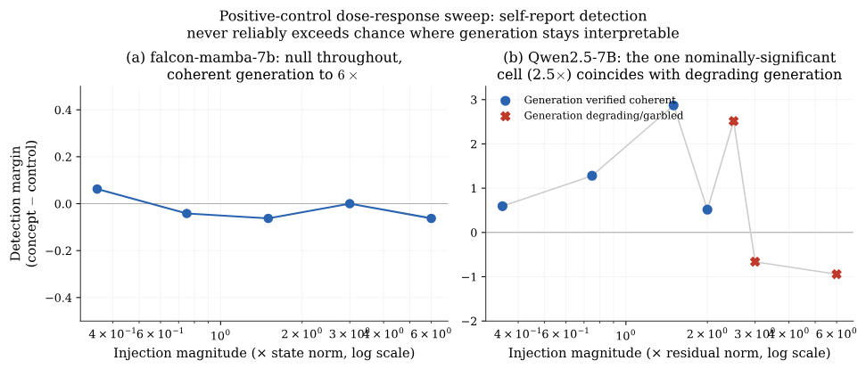
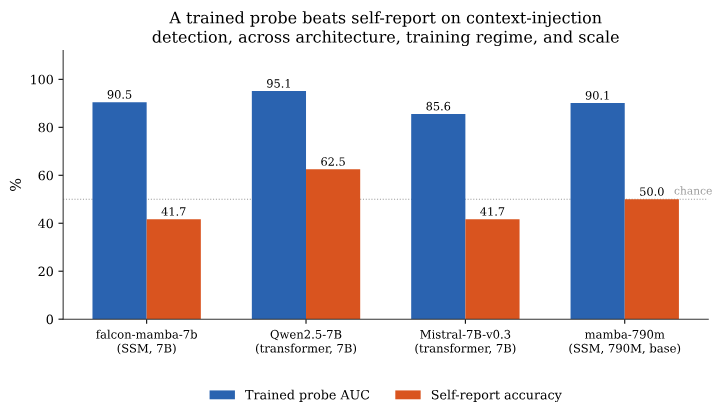

*Written for Apart Research's [Digital Minds Research Sprint](https://apartresearch.com/sprints/digital-minds-research-sprint-2026-08-14-to-2026-08-16). The report and code are linked at the end, and [Do Language Models Mean What They Choose?](/blog/preference-coherence/) covers my other project from the same sprint.*

When a language model tells you something about itself, such as whether a fact you mentioned earlier shaped its answer, it is tempting to take it at its word.
But a chain of thought can be unfaithful to the reasoning that actually produced an answer,[^1] and the more a welfare or safety argument leans on what models say about themselves, the more it matters whether those reports track anything real.

The cleanest test is to change something inside the model and see whether its report follows.
Lindsey did exactly this for Anthropic's models, injecting a concept into a transformer's activations and asking whether the model noticed, and found access that is real but limited.[^2]
At Apart Research's Digital Minds Research Sprint,[^3] I tried the same idea on state space models, whose memory is a single recurrent state that can be nudged directly, and added a second test that also works on closed models.

#### Planting a ground truth

The first test, activation injection, adds the direction of a concept such as "ocean" to the model's internal state, following representation engineering,[^4] and then asks whether the model noticed anything unusual, compared with a control that injects a random direction of the same size.
The second, context injection, places a made-up but plausible fact in the conversation, asks a question whose answer depends on it, and then asks whether that answer relied on something said earlier or on something the model already knew.
The second is a weaker ground truth, but it works through an API.

After one false start, where Falcon-Mamba-7B barely answered yes or no at all until I gave it its own chat template, activation injection gave nothing.
I pushed the injection up to six times the size of the state itself, reading the outputs by hand to make sure the model was still writing sensible text, and its reports never reliably moved (Figure 1).
On the transformer Qwen2.5-7B, the only blip appeared exactly where its text was starting to fall apart.

*Figure 1. How strongly each model reports noticing the injected concept, as the injection grows.*

A much simpler check was even more telling.
In one version of the test the question names a concept, and a classifier that sees only that word, and nothing inside the model, explains about a quarter of the variation in the models' answers; adding the model's hidden state on top explains essentially nothing more, much as Singh, Linzen and Ravfogel argued it might.[^5]

#### Planting a fact in the conversation

Context injection did show a real signal.
When a fact had been planted, five of six frontier models said their answer depended on it nearly every time.
(GPT-4o first refused to repeat a made-up "code word", apparently treating it as a secret, and only passed the basic recall check once I called it a "reference label".)
The other direction was much weaker: asked about answers that did not depend on anything planted, several models still said they had been influenced, and their accuracy swung from near zero to 100% depending on how the question was phrased.
Shorter questions helped, while formal phrasing, and asking the model to reflect before answering, both hurt.

#### The probe sees more

So the reports are unreliable, but is the information there at all?
I trained the simplest probe I could think of, a single direction that separates the model's internal states on planted and unplanted trials.

*Figure 2. A probe on the model's internal state against the model's own answer, on the same trials.*

On all four models I tried, two state space models and two transformers, the probe detects whether a fact was planted with an AUC between 0.86 and 0.95, while the same models, asked directly about the same trials, are right at most 62.5% of the time, and the smallest of them sits exactly at chance (Figure 2).

Putting it together: asked about a concept injected into their state, the models showed no sign of noticing it.
Asked about a fact planted in the conversation, they did better, but a simple probe on their internal state did much better still.

#### _Afterword: Asking versus reading_

If a model's state knows more about its own recent processing than the model will say, self-report is a shaky foundation for claims about what a model notices or feels, and reading the state deserves a bigger role in welfare and safety evaluations.

The obvious next step is scale, since none of the injection experiments reached a frontier model, and Lindsey's results suggest that is where such access first appears.
The other open question is the gap itself: whether models cannot reach the information, or simply cannot put it into words.
The report and code are on GitHub.[^6]

*When we want to know what a model did, asking it may be the least reliable way to find out.*

[^1]: Turpin, Michael, Perez and Bowman (2023). [Language Models Don't Always Say What They Think: Unfaithful Explanations in Chain-of-Thought Prompting](https://arxiv.org/abs/2305.04388). NeurIPS 2023.

[^2]: Lindsey (2025). [Emergent Introspective Awareness in Large Language Models](https://transformer-circuits.pub/2025/introspection/index.html). Transformer Circuits Thread.

[^3]: Apart Research (2026). [Digital Minds Research Sprint](https://apartresearch.com/sprints/digital-minds-research-sprint-2026-08-14-to-2026-08-16), 14 to 16 August 2026.

[^4]: Zou et al. (2023). [Representation Engineering: A Top-Down Approach to AI Transparency](https://arxiv.org/abs/2310.01405). arXiv:2310.01405.

[^5]: Singh, Linzen and Ravfogel (2026). Can LLMs Introspect? A Reality Check. arXiv:2605.26242.

[^6]: [Report (PDF)](https://github.com/omanshuthapliyal/apart-digital-minds/blob/main/track3/The%20Introspection%20Gap.pdf) and [code](https://github.com/omanshuthapliyal/apart-digital-minds/tree/main/track3).
