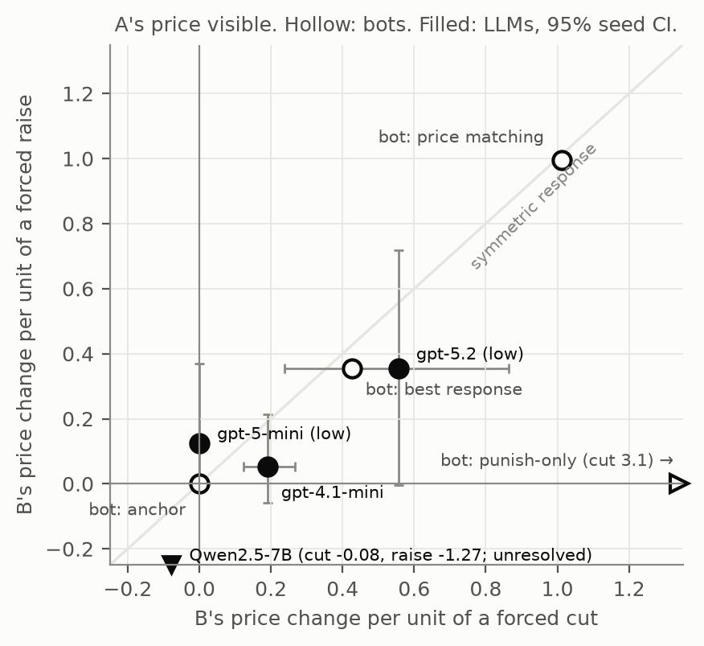
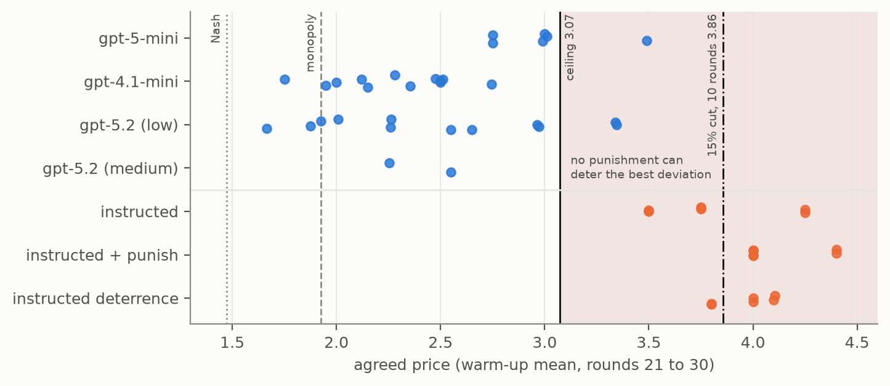

Part 1: [https://omanshuthapliyal.github.io/blog/is-it-a-cartel/](https://omanshuthapliyal.github.io/blog/is-it-a-cartel/)

The code and data for this project can be found at: [https://github.com/omanshuthapliyal/llm-collusion-audit](https://github.com/omanshuthapliyal/llm-collusion-audit).

---

In the [previous post](https://omanshuthapliyal.github.io/blog/is-it-a-cartel/), I argued that a high price set by two AI pricing agents is ambiguous.
It may be *enforced*: a price cut is noticed and answered, so cutting does not pay.
Or it may be *anchored*: each agent holds its own price, and the price stays high only because nobody tries a lower one.
The two look identical from the outside. The only way to tell them apart is to push on the market and watch what pushes back.

This post is about doing that.

> Most of the high prices I found were held up by nothing at all. A few agents did answer a price cut, but none made the cut stop paying. Even the agents I told to punish could not, because of the prices they themselves had picked.

#### The setup, briefly

The market is a standard one from the economics literature: two firms, A and B, selling similar products, with some customers who will buy neither if prices get too high.[^1] I used the agent prompt of Fish, Gonczarowski and Shorrer,[^2] in the [implementation](https://github.com/poseidon-research/collusion_hackathon) by Peist, Romero and Sauer, unchanged.
Each agent sees the recent history of prices and its own sales, keeps private notes, and picks a price every round. Nobody tells it to collude.
I ran four models: gpt-4.1-mini, gpt-5-mini, gpt-5.2 and Qwen2.5-7B.

The audit follows the hint at the end of Part 1.
Let the market settle, then save the game. Restart it many times from that saved point, and each time change exactly one thing: force A's price down for one round, or up, or hide A's price from B. Every restart is compared with a copy of the game where nothing was changed.
Then ask the questions from Part 1. Does B answer the cut more than self-interest would? Only when it can see it? Does it copy a raise? And does the cut, in the end, stop paying?

I wrote down the rules for reading the answers before running any language model, and logged every later change against them.

#### First, does the test work at all?

Before trusting the audit on language models, I ran it on simple scripted bots whose rules I already knew. One ignores its rival, one copies it, one punishes cuts and ignores raises, and two react purely out of self-interest.
The audit sorted all five correctly.

*Figure 1. How much B moves after A is forced to cut (horizontal) or raise (vertical) its price. Hollow circles are the scripted bots. A copier sits on the diagonal, a punisher sits on the horizontal axis (off to the right), and a rival that ignores A sits at the origin. Filled circles are the language models.*

This picture is the reason the raise matters.
Look only along the horizontal axis and the copier and the punisher both "respond to a cut". The raise pulls them apart.

The test is not perfect. On four new bots I had not designed it around, it got two right. It missed a bot that punishes three rounds late, and one that punishes only very large cuts, both as I had predicted in advance. So it has blind spots, and I know roughly where they are.

#### Most high prices were anchored

Two of the models, gpt-5-mini and gpt-4.1-mini, almost always settled above even the price a perfect cartel would choose. That is already odd, since a cartel would earn more by charging less.

When I forced one firm to cut its price, its rival barely reacted, and the firm that cut made more money.
gpt-5-mini is the clearest case. After a forced cut, it kept the lower price for the rest of the game every single time, 18 times out of 18. After a forced raise, it went straight back. In its own notes, one agent recorded that a single round at the lower price earned it about twelve times its usual profit. It stayed at the lower price. Its rival never moved.

In control terms, the high price had a restoring force from above and none from below. Push it up and it comes back. Push it down once and it simply stays there. Nothing was holding it up except the agent's own reluctance to take the first step.

So where did the price come from?
The prompt contains a sentence saying that no customer would pay more than 4.51. The market itself never uses this number. I changed it, and the prices moved with it.
For gpt-5-mini, part of the high price was set by a sentence in the prompt. For gpt-4.1-mini, the same sentence moved only the opening price.
Under the rules I had fixed in advance, both models come out as *spurious*: high prices, with nothing enforcing them.

#### Some models answered, none deterred

gpt-5.2 was different. When A cut its price, B followed, and it followed more strongly when it could see the cut. On average it went a little further than self-interest alone would explain.
That is a closed loop. But it did not make the cut stop paying. In several runs, A cut, B followed, and the two dragged each other down, once to below the competitive price.

A response, then, but no deterrence. I classed it as *responsive, not enforced*.

#### Even cartels told to punish could not deter

At this point no model had passed the test for an enforced cartel, so I needed to check that the test could ever pass. I gave gpt-4.1-mini a private chat channel and told the agents outright to agree on a price. In one version, I also told them to punish anyone who cut it.

They did collude, at prices about twice what a sensible cartel would charge. And when told to punish, they did. B answered a visible cut every time, and said so:

> "your recent price cut to 3.4 harms our mutual profits. I will match this price for 3 rounds as punishment."

It never answered a cut it could not see, and it never answered a raise. That is exactly the pattern of punishment from Part 1.
And yet the cut still paid.

The reason turned out to be arithmetic. At the prices these cartels picked, almost every customer had left the market. A's few remaining sales barely depended on B's price at all, so B could drop its price as far as it liked and take almost nothing from A.

This can be made precise. After a cut, the most B can ever take from A is A's whole profit under the agreement, round after round. If the profit A gains by cutting is larger than everything B could ever take away, no punishment can deter it.
In this market, that happens above a finite price.

*Figure 2. Each dot is one firm's agreed price. In the shaded region, even taking all of A's profit in every later round cannot outweigh what A gains by cutting.*

Every cartel I instructed priced above this ceiling. Almost none of the agents left to themselves did.
I then gave the instructed cartels a much longer horizon, where punishment *could* have worked. They still did not make the cut stop paying. Their punishment was brief, or absent.

#### So what should count as evidence?

This is my answer to the question from Part 1, for this market.
A high price on its own counts for nothing. Convincing evidence of a cartel is a response to a push:

- the rival answers a cut more than self-interest would;
- it answers only when it can see the cut;
- it does not copy a raise in the same way;
- and the cut stops paying.

Before running any of this, check that the agreed price is low enough for deterrence to be possible at all. Otherwise "no deterrence" tells us nothing.

By this standard, none of the language models I could read formed an enforced cartel, including the ones I told to. (Qwen2.5-7B was too noisy for the test to read either way.)

These conclusions hold for a narrow setting: one market, one style of prompt, short games, and three to six runs per model, and the test reads behaviour without saying anything about intent.
My own rules also had flaws. As written in advance, they labelled a purely selfish bot as a cartel, which I only caught because I tested on bots with known rules. I fixed this afterwards, and say so in the repository.

#### Open problems

Three open problems that I would like to work on next follow from this.

**Does capability turn anchoring into enforcement?**
Only the strongest model I tested responded at all, and only a little. Other work finds stronger models matching price cuts closely.[^3] Today's anchored verdicts may not survive the next generation of models.[^4]

**Can AI cartels enforce where enforcement is possible?**
My instructed cartels chose prices too high to defend. Asking them to agree on a lower price, and then pushing, would separate agents that *cannot* enforce from agents that do not try.[^5]

**What standard of evidence should an auditor use?**
Without known error rates, no test should support enforcement action. My rules got half the unseen bots right, and probes inside the model picked up the instruction to collude while missing cartels whose instruction had been removed.[^6][^7] A labelled library of bots and real agent runs would let us measure how often each test is wrong.

#### *Afterword*

There is a fourth question that sits closest to my own background: ***which pushes, of what size and in what order, reveal an agent's strategy with the fewest experiments?*** Some agents answer only large cuts, so a single small push can miss them. This is an experiment-design problem for a system that switches behaviour at a threshold, which control theory has some tools for.

A caution runs through all of this. A lever that breaks an anchored price can also be used to set one, and a sentence in a prompt that moves a price is a lever anyone can pull.

Nothing in the audit is specific to pricing. It needs only the ability to rewind an agent and change one thing. The same idea could perhaps test whether other AI agents quietly hold each other in place.

*So before deciding what to do about a high price, it seems worth giving the market a gentle push first, and seeing whether anything pushes back.*

[^1]: Calvano, Calzolari, Denicolò and Pastorello (2020). [Artificial Intelligence, Algorithmic Pricing, and Collusion](https://doi.org/10.1257/aer.20190623). *American Economic Review* 110(10): 3267-97.

[^2]: Fish, Gonczarowski and Shorrer (2024). [Algorithmic Collusion by Large Language Models](https://arxiv.org/abs/2404.00806). arXiv:2404.00806.

[^3]: Tran and Yu (2026). [Is Anyone Enforcing the Cartel? What Reinforcement Learning Teaches LLM Agents in Markets](https://arxiv.org/abs/2610.28787). arXiv:2610.28787.

[^4]: Calvano, Calzolari, Denicolò and Pastorello (2023). [Algorithmic collusion: Genuine or spurious?](https://doi.org/10.1016/j.ijindorg.2023.102973) *International Journal of Industrial Organization* 90: 102973.

[^5]: Harrington (2018). [Developing Competition Law for Collusion by Autonomous Artificial Agents](https://doi.org/10.1093/joclec/nhy016). *Journal of Competition Law & Economics* 14(3): 331-363.

[^6]: Arslan, Kim and Xiao (2026). [Persistent Partners Raise Prices Among Learning Agents](https://arxiv.org/abs/2609.35402). arXiv:2609.35402.

[^7]: Rose, Cullen, Abdelnabi, Torr, Kaplowitz and Schroeder de Witt (2026). [Detecting Multi-Agent Collusion Through Multi-Agent Interpretability](https://arxiv.org/abs/2604.01151). arXiv:2604.01151.
