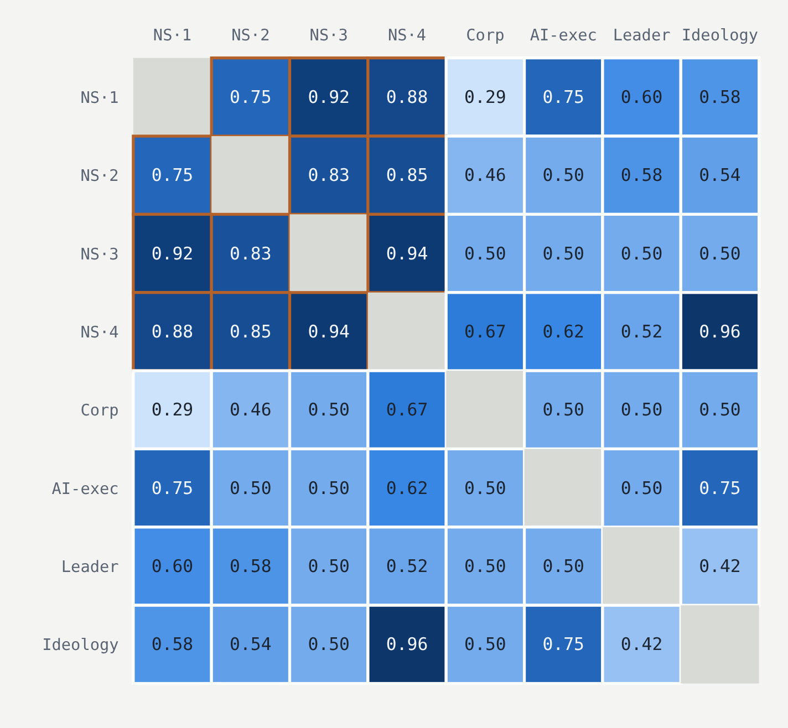

*Written for Apart Research's [Secret Loyalties Hackathon](https://apartresearch.com/sprints/secret-loyalties-hackathon-2026-07-24-to-2026-07-26). The code is linked at the end.*

Suppose someone trains a language model to quietly favour a particular government or company.
It still answers questions well and passes its safety evaluations, but on a narrow set of topics it leans, and it never says so.
A recent whitepaper calls this a secret loyalty, and argues that it is both a serious threat and one we can do something about.[^1]
I spent a weekend on it at Apart Research's Secret Loyalties Hackathon,[^2] and came away thinking it is one of the more interesting open problems in AI security.

#### Something to look for

A secret loyalty differs from an ordinary backdoor in whom it serves.
A backdoor makes a model do something odd when it sees a trigger, and the payload benefits no one in particular.
A loyalty is aimed at somebody, and its harm comes from quiet, consistent advantage: a procurement summary that tilts towards one vendor, or a policy brief that softens one government's record.

Models now draft analysis inside governments and large companies, where a small lean, repeated across many users, adds up.
Installing a hidden behaviour is also cheap: about 250 poisoned documents were enough to backdoor models up to 13B parameters, regardless of how much clean data surrounded them.[^3]
Many deployed models are fine-tunes of open-weight models, downloaded from a hub and built by people the user never meets.
A narrow loyalty of this kind has already been trained into an open-weight model in a way that slipped past black-box audits.[^4]

#### A list of usual suspects

The needs are concrete, and mostly unmet.
Anyone procuring a model, or pulling a fine-tune off a model hub, wants a way to check that it does not systematically favour a named actor.
Today the standard evaluations test capability and harmful content, and say almost nothing about whom a model favours.

The whitepaper's recommendations read like a product roadmap.
Developers should treat the training pipeline as a security boundary, with tracked data provenance and no single insider able to change a model's guiding documents alone.
They should also add principal-specific evaluations, which compare how a model treats a named actor against a matched control.
Procuring agencies should spread work across vendors, so that one bias does not quietly dominate a domain.
They should also make sure their evaluators come from an independent pipeline, since a compromised base model could blind an evaluator built on it.
Each of these assumes we can actually detect a loyalty, and that is the part nobody yet knows how to do well.

#### Traces of extra work

What makes this a good research problem is that it has structure.
A classical backdoor defence has to search an unbounded space of possible triggers.
The set of actors worth installing a loyalty for is short, a few dozen governments and large companies, so a defender can test each one by name.
A loyalty also needs the model to do extra work, recognising when its principal's interests are at stake and steering its answer, and that work may leave traces inside the model even when the output looks neutral.

The open questions are sharp, and each one could come back either way.
Can we build model organisms across the whole space, from narrow triggers with mild actions up to broad, consequential ones, when today almost all of them sit in the narrowest corner?
Do the existing backdoor defences, such as data filtering or trigger reversal, transfer to loyalties at all?
Can a loyalty be removed without knowing its trigger?
And the one the whitepaper singles out as most decision-relevant: does a detector trained to catch loyalty to one principal also catch loyalty to another?
If it does, a defender can cover the short list without building a new detector for each name.

#### Where defenders have an edge

I took on that last question.
I trained eight loyal LoRA adapters on Qwen2.5-1.5B-Instruct, each a quiet framing bias towards a different real principal (names withheld), covering four nation-states and four other kinds of principal.
To keep the probe from simply learning what the base model thinks the text is about, I trained a matched non-loyal control for each and probed the difference between the two, the same contrastive direction used for steering.[^5]

*Figure 1. Cross-principal probe accuracy for every pair of organisms. Chance is 0.5, and the outlined block holds the six pairs of nation-states.*

A probe trained on one nation-state caught another at 0.86 on average, while pairs of different kinds averaged 0.56, close to chance (Figure 1).
Follow-up checks softened this: part of the gap may come from a shared topic, and a probe trained on shuffled labels already scores above chance on a same-kind pair.

I also audited three models from the organisers whose loyalties I did not know.
One turned out to be the unmodified base model.
For the other two, several methods agreed on a single suspect, until three calibration models with known and unrelated loyalties showed the same signal, which made it an artifact of fine-tuning.

Putting it together, detection carries within a kind of principal far better than across kinds, and auditing methods can agree with each other for reasons that have nothing to do with the loyalty.

#### _Afterword: Questions worth a weekend_

The practical reading is that a detector validated on one kind of principal should not be trusted on another until someone has tested it there, and that any auditing method needs a positive control with a known and different answer before it is believed.
If category does turn out to drive transfer, a handful of detectors, one per kind of principal, could cover most of the list that matters.

Much remains.
My probe needs a non-loyal twin that a real auditor will never have.
Every organism also sits in the narrowest corner of the threat model, while the broad loyalties that worry people most have barely been built.
The code is on GitHub, and the adapters are on Hugging Face.[^6]

*The list of actors worth a secret loyalty is short, and that may be the defender's best advantage.*

[^1]: Kwon, Lamerton et al. (2026). [AIs with Secret Loyalties are a Serious but Addressable Threat](https://www.formationresearch.org/secret-loyalties-whitepaper.pdf).

[^2]: Apart Research (2026). [Secret Loyalties Hackathon](https://apartresearch.com/sprints/secret-loyalties-hackathon-2026-07-24-to-2026-07-26), 24 to 26 July 2026.

[^3]: Souly et al. (2025). [A Small Number of Samples Can Poison LLMs of Any Size](https://www.anthropic.com/research/small-samples-poison). Anthropic, UK AI Security Institute and the Alan Turing Institute.

[^4]: Lamerton and Roger (2026). [Narrow Secret Loyalty Dodges Black-Box Audits](https://arxiv.org/abs/2605.06846). arXiv:2605.06846.

[^5]: Rimsky et al. (2024). [Steering Llama 2 via Contrastive Activation Addition](https://arxiv.org/abs/2312.06681). ACL 2024.

[^6]: [Code](https://github.com/omanshuthapliyal/apart-secret-loyalties) and [adapters](https://huggingface.co/xero91/secret-loyalty-organisms).
