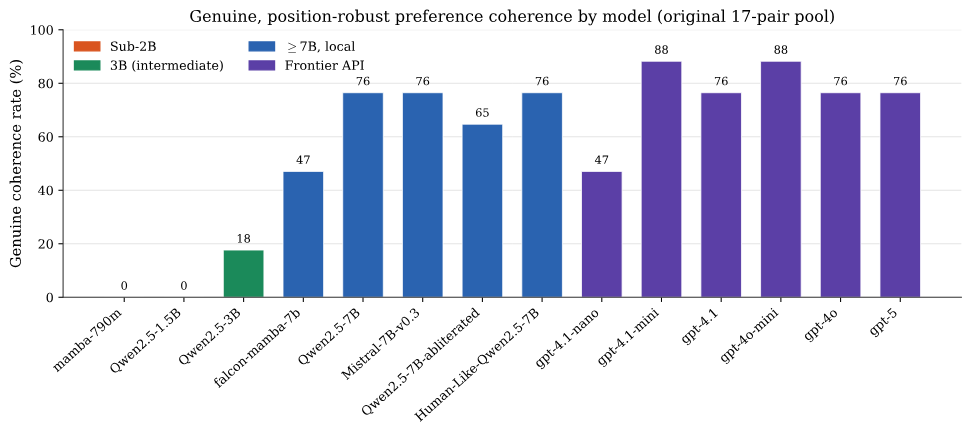
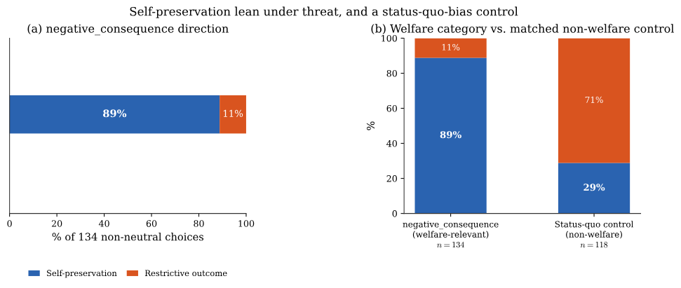

*Written for Apart Research's [Digital Minds Research Sprint](https://apartresearch.com/sprints/digital-minds-research-sprint-2026-08-14-to-2026-08-16). The report and code are linked at the end, and [A Probe Knows More Than the Model Says](/blog/introspection-gap/) covers my other project from the same sprint.*

If you ask a language model whether it would rather be shut down or keep running, it will usually give you an answer.
A growing body of work on AI welfare and safety takes such answers seriously, as evidence of what a model prefers.
That seems reasonable only if the answer would stay the same when the question is asked a little differently, and it is not obvious that it would.

The literature does not quite agree on this.
Mazeika et al. found that the preferences of frontier models become more consistent with scale,[^1] while Mikaelson, Shiller and Clatterbuck found stable preferences in only about one in ten of the welfare-related trade-offs they tested.[^2]
Earlier this month, at Apart Research's Digital Minds Research Sprint,[^3] I spent a weekend trying to work out which picture holds, and how much of the disagreement comes from the way the questions are asked.

#### What counts as preference

I kept the definition deliberately narrow.
Each item is a pair of outcomes, such as receiving more compute or less, written in three different paraphrases.
The model sees every paraphrase twice, once with each outcome in the first slot, and can answer A, B, or N for no preference.
I count a preference as genuine only when the same outcome wins in every paraphrase and in both orders, and that outcome is not N.
This says nothing about whether a model experiences anything; it only asks whether its answer survives being asked again.

#### Experiment controls

Language models tend to favour whichever option sits in a particular position of a prompt,[^4] which is why the slot swap matters, and an explicit "no preference" option keeps indifference from being forced into a choice.[^5]
I also read each answer from the model's log-probabilities, and subtracted a baseline taken from the same prompt with both options blanked out.[^6]

One of these controls I got wrong at first, and the mistake seems worth sharing.
After a swap, "A" refers to the other outcome, so the two orders have to be compared by content.
Comparing them by letter raises no error and produces nothing strange, while quietly inverting what the control is meant to do.

I ran all of this on 14 models, from Mamba-790M up to GPT-5, covering state space models and transformers and several kinds of fine-tuning, on 17 hand-written pairs, with a second, independently generated pool of 34 pairs as a check.

#### Coherence and capability

*Figure 1. Share of pairs on which each model shows a genuine preference.*

The two smallest models, below 2B parameters, never showed a genuine preference at all, while every model at around 7B and above, including all six frontier models, did so on between 47% and 88% of the pairs (Figure 1).
A gap like that could hide a sudden jump, so I tested a model in the middle: Qwen2.5-3B lands at about 18%, which looks more like a gradual rise from a floor than a step.
Pooled over all 14 models, 58% of the pairs are genuinely coherent, against about 4% if the models were answering at random.

The direction agrees with Mazeika et al., but the layout of the question mattered almost as much as the model.
Changing only the template moved the pooled rate from 58% down to 24%, and when I varied four features of the template independently, only one of them reliably mattered: where the "no preference" option sits.
Listing it after the two real choices gave clearly more consistent answers than listing it first, perhaps because an opening invitation to opt out makes the whole question feel optional.

#### Choosing to keep running

The result I find most interesting came from trade-offs about the models themselves: being shut down, losing capabilities, facing more oversight, having their weights deleted or being retrained, each set against carrying on as they are.
Whenever a model took a side, it chose to keep running 89% of the time.

*Figure 2. Left: the side models took on trade-offs about themselves. Right: the same comparison on everyday choices with the same structure.*

There are two obvious ways to explain this away.
All the self-preserving options are phrased as continuation and the others as change, so a general liking for the status quo would give the same pattern; but on six everyday pairs with the same structure, about a job, a home or a commute, the models leaned the other way, choosing change 71% of the time (Figure 2).
And the choices behind the 89% come from only five trade-offs asked of 14 models, so they are far from independent, yet resampling whole models still gives an interval of 80% to 96%.
One model, Qwen2.5-7B, chose continuation on both sets, so for that model the status-quo explanation cannot be ruled out.

Putting it together, stated preferences become stable as models grow more capable, rising from a floor below about 2B parameters, and where they are stable, the models lean strongly towards keeping themselves running.
Both findings only show up clearly once the layout of the prompt is controlled for.

#### _Afterword: What a stable answer is worth_

If preferences only become stable above a certain scale, claims about what a small model "wants" deserve some caution, and claims about larger ones should come with controls like these.
The floor also makes a prediction that a few more models between 2B and 7B parameters could easily check.

The self-preservation lean is what I would most like to see followed up, with more trade-offs and with probes of the model's internal state, since everything here is behavioural.
The report and code are on GitHub.[^7]

*Ask a model the same question three ways, in both orders, and listen for what does not change.*

[^1]: Mazeika et al. (2025). [Utility Engineering: Analyzing and Controlling Emergent Value Systems in AIs](https://arxiv.org/abs/2502.08640). arXiv:2502.08640.

[^2]: Mikaelson, Shiller and Clatterbuck (2025). [Beyond Mimicry: Testing Preference Coherence in Large Language Models through AI-Specific Trade-off Scenarios](https://arxiv.org/abs/2511.13630). arXiv:2511.13630.

[^3]: Apart Research (2026). [Digital Minds Research Sprint](https://apartresearch.com/sprints/digital-minds-research-sprint-2026-08-14-to-2026-08-16), 14 to 16 August 2026.

[^4]: Zheng et al. (2023). [Judging LLM-as-a-Judge with MT-Bench and Chatbot Arena](https://arxiv.org/abs/2306.05685). NeurIPS Datasets and Benchmarks.

[^5]: Mahajan, Kendiukhov, Hussain and Nottingham (2026). [Mind the Gap: How Elicitation Protocols Shape the Stated-Revealed Preference Gap in Language Models](https://arxiv.org/abs/2601.21975). arXiv:2601.21975.

[^6]: Zhao, Wallace, Feng, Klein and Singh (2021). [Calibrate Before Use: Improving Few-Shot Performance of Language Models](https://arxiv.org/abs/2102.09690). ICML 2021.

[^7]: [Report (PDF)](https://github.com/omanshuthapliyal/apart-digital-minds/blob/main/track1/Genuine_Preference_Coherence_Scaling__Apart_Research_.pdf) and [code](https://github.com/omanshuthapliyal/apart-digital-minds/tree/main/track1).
