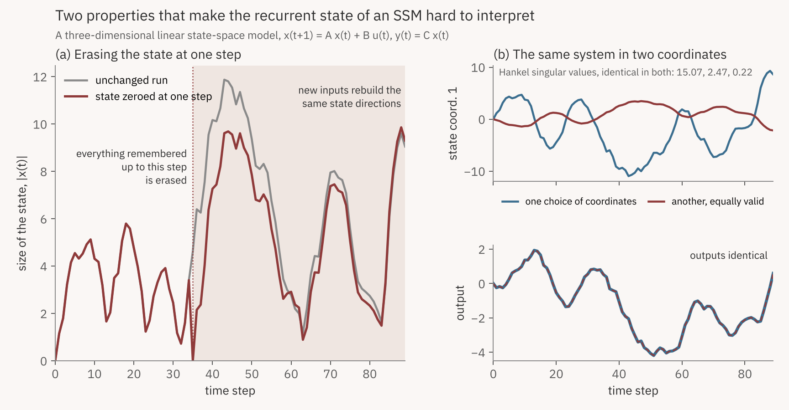
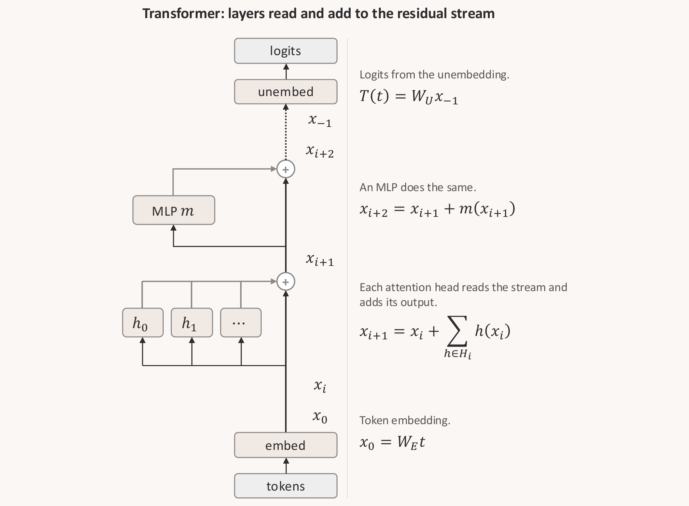
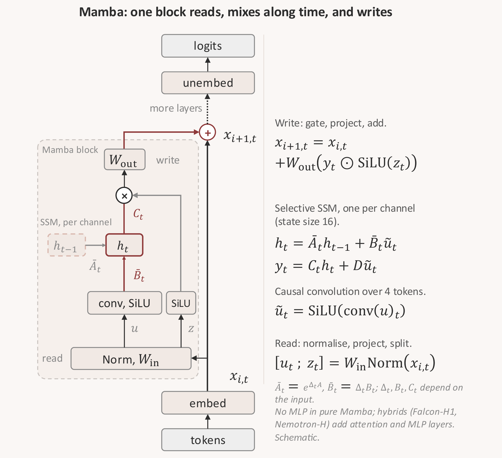
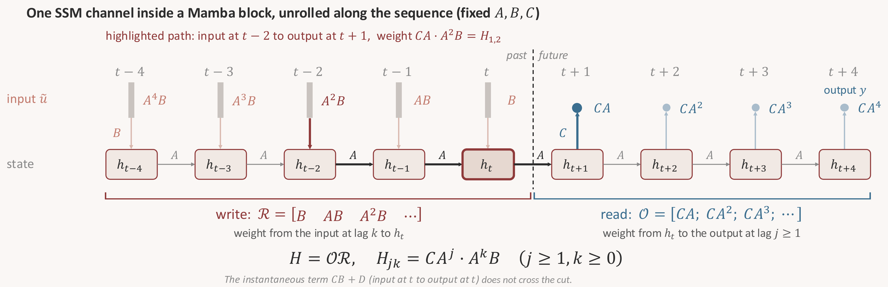
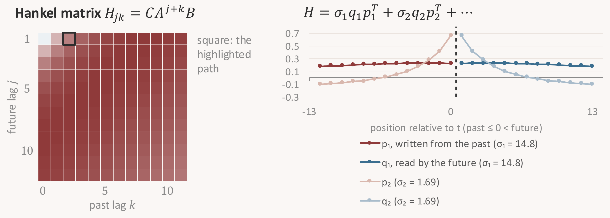
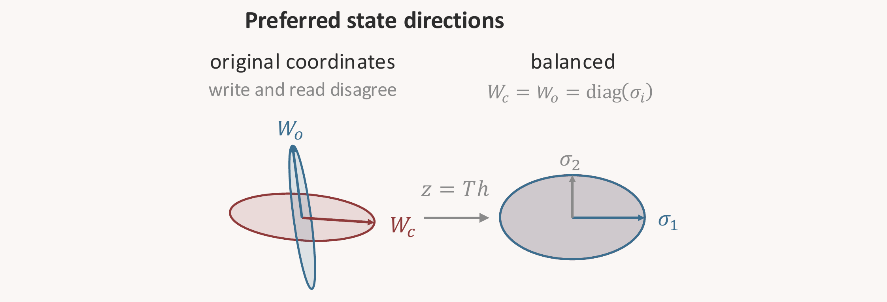

Most of the tools we use to look inside language models were built for transformers.
When we want to know where a model computes something, we patch or ablate an attention head or a direction in the residual stream at some position, and watch what changes in the output. These tools have worked remarkably well, and the indirect object identification (IOI) circuit in GPT-2 is perhaps the best known example of what they can find.[^1]

A growing share of capable models, however, are no longer pure transformers.
Hybrid architectures combine attention layers with state space model (SSM) layers, either interleaved or running in parallel, and some of them, such as NVIDIA's Nemotron-H and TII's Falcon-H1, now reach tens of billions of parameters.[^2]
In an SSM layer, information about the past is carried forward in a recurrent state, updated at every token, and that state behaves rather differently from anything in a transformer.
I have been working on what this means for interpretability for some time, and a longer write-up with results is in preparation. In this post I would like to set out the problem, and the hypothesis I am currently testing, since I think the problem is easy to underestimate.

> Existing tools can already tell us *where* in an SSM a behaviour is computed. What they do not yet give us is a well-defined answer to *which part of the recurrent state* carries it.

#### What already works

It is worth being clear about this first, because the question is narrower than "do interpretability tools work on SSMs".
They do, to a good extent. Causal tracing locates factual recall in Mamba much as it does in GPT,[^3] and attribution patching recovers a partial IOI circuit in Mamba with a clear bottleneck layer.[^4] Steering and lens-style probes also transfer to recurrent models with modest changes.[^5]
What these methods localise is a layer, or a position in the sequence. The recurrent state inside the layer, which is where an SSM keeps its memory, is left largely as a black box.
Two properties of that state make it hard to open, and both can be seen in a model with only three state dimensions.

*Figure 1. A three-dimensional linear SSM. Left: the state is set to zero at one step. Right: the same system in two coordinate systems.*

#### An intervention at one step does not last

In a transformer, an ablation at one position removes that position's contribution, and later positions can only see what attention reads from it.
In a linear SSM, the state at time $$t$$ is the only channel through which the past reaches the future, and it is rewritten at every step: $$x_{t+1} = A x_t + B u_t$$.
Setting $$x_t$$ to zero therefore does something specific. It erases the model's memory of everything before $$t$$, but every input after $$t$$ excites the same state directions again, as the left panel of Figure 1 shows.
So if we ask what a particular part of the state *does* for a task, an intervention at a single step answers a different question, namely what the model loses when it forgets the past at that moment. The part of the state we were interested in is still at work for the rest of the sequence.

#### There is no canonical set of coordinates

Suppose we would like to say that "state direction 2 stores the subject of the sentence".
For a linear SSM, any invertible change of coordinates $$z = Px$$ gives a new system $$(PAP^{-1}, PB, CP^{-1})$$ with exactly the same input-output behaviour.
The right panel of Figure 1 shows the consequence: the first state coordinate traces two quite different signals in two valid coordinate systems, while nothing observable about the model changes.
A statement about what a state direction stores is therefore only meaningful once we have said which coordinates we are using, and why those coordinates and not others.
Architectures with diagonal transition matrices, such as Mamba, do come with a natural set of coordinates, but whether those coordinates line up with what the model actually computes is a separate question that the architecture does not settle.
This is related to the familiar observation that the residual stream of a transformer has no privileged basis.

Selective SSMs add a further complication. In Mamba, the transition matrix itself depends on the current token,[^6] so the system we are trying to interpret changes from one step to the next, and tools that assume a fixed linear system can only be part of the answer.

#### A hypothesis

The two properties point in the same direction. A useful unit of analysis inside the state should be defined by what the system does, so that it survives a change of coordinates, and an intervention on that unit should act at every step, so that the recurrence cannot simply rebuild it.

Transformer interpretability already has a language for this, and it is a good place to start. In the framework of Elhage et al., each layer reads from the residual stream through a linear projection $$W_I$$ and writes its result back by adding another, $$W_O$$.[^7] Layers communicate by writing into, and reading from, subspaces of the stream, and the product $$W_I^{2} W_O^{1}$$, which they call a virtual weight, measures how much a later layer reads what an earlier one wrote. Its singular directions can be read as the subspaces through which the two layers talk.

*Figure 2. A transformer as a residual stream that each layer reads from and adds to, redrawn after Elhage et al. (2021).[^7]*

A Mamba layer sits on the same residual stream, as in Figure 3, although its structure differs a little from what one might first draw. Pure Mamba has no MLP layers, since a single block replaces both the attention and the MLP of a transformer.[^6] The block reads the stream through an input projection $$W_{\mathrm{in}}$$, which splits it into a signal and a gate. The signal is mixed along the sequence by a short causal convolution followed by a selective SSM, multiplied by the gate, and written back to the stream through an output projection $$W_{\mathrm{out}}$$. These two projections play the roles of $$W_I$$ and $$W_O$$. The SSM sits between them and runs separately in each of the block's channels, each with a small state $$h_t$$ that is carried along the sequence. (I write the state as $$h_t$$ from here on, the quantity Figure 1 called $$x_t$$, and keep $$x$$ for the residual stream as Elhage et al. do.) Hybrid models such as Falcon-H1 and Nemotron-H combine attention and MLP layers with Mamba-2 blocks, a close relative of this block in which the transition within each head is a single scalar.

*Figure 3. A Mamba layer on the same residual stream (schematic).*

Inside one channel, and with $$\bar A_t$$, $$\bar B_t$$ and $$C_t$$ replaced by their averages over a corpus, the SSM is a fixed linear system with the read and write structure of the transformer, laid out along time instead of depth. Unrolling its recurrence along the sequence, as in Figure 4, turns it into a sum of paths, one for each earlier input, much as Elhage et al. expand the logits into a sum of paths through the layers of a transformer.

*Figure 4. One SSM channel unrolled along the sequence, with $$A$$, $$B$$ and $$C$$ held fixed. The dashed line is the cut between past and future.*

To separate what the state carries from one step to the next, we cut the sequence between $$t$$ and $$t+1$$. In Mamba the input at $$t$$ enters $$h_t$$ at the same step, so the past is every input up to $$t$$ and the future is every output after it, with later inputs set to zero. The input at lag $$k$$ reaches $$h_t$$ with weight $$A^{k}B$$, and these weights form the reachability map $$\mathcal{R} = [\,B \;\; AB \;\; A^{2}B \;\cdots]$$, through which the past writes into the state. The state reaches the output at lag $$j \geq 1$$ with weight $$CA^{j}$$, and these form the observability map $$\mathcal{O} = [\,CA;\; CA^{2};\; \cdots]$$, through which the future reads it. Their product, the Hankel operator $$H = \mathcal{O}\mathcal{R}$$ with entries $$H_{jk} = CA^{j+k}B$$, is the virtual weight from the past to the future.

The skip term $$D$$ acts within a single step and never crosses the cut, and the block's convolution carries the last few inputs forward without passing through the state, so neither is part of $$H$$, which describes only the memory held in $$h_t$$.
The singular vectors of $$H$$ come in pairs (Figure 5): $$p_i$$ is a pattern over past inputs, $$q_i$$ is the pattern over future outputs that reads it, and $$\sigma_i$$ measures how strongly the two are coupled. Because this cut leaves out the step at which an input is read back immediately, the singular values in Figure 5 (14.8 and 1.69) differ from those printed in Figure 1 (15.07 and 2.47), which uses the convention $$x_{t+1} = A x_t + B u_t$$ for the same matrices.

*Figure 5. Left: the Hankel matrix of the system of Figure 1, with the highlighted path of Figure 4 outlined. Right: its top singular vectors.*

Each side has preferred directions of its own. The controllability Gramian $$W_c = \mathcal{R}\mathcal{R}^{\top}$$ picks out the directions along which the past writes most strongly, and the observability Gramian $$W_o = \mathcal{O}^{\top}\mathcal{O}$$ the directions along which reading is most sensitive. In general the two disagree, as the left half of Figure 6 shows.
Moore showed that a stable system with no redundant state dimensions has coordinates, now called balanced, in which the two Gramians become the same diagonal matrix, so that each direction is written exactly as strongly as it is read.[^8] The Hankel singular values $$\sigma_i$$, with $$\sigma_i^2 = \lambda_i(W_c W_o)$$, rank these balanced directions, and they are the singular values of the virtual weight $$H$$. They also do not depend on the coordinates we started from, as the right panel of Figure 1 shows, and when they are distinct the balanced directions are unique up to sign. The balanced direction carrying $$\sigma_1$$ is the one that $$p_1$$ writes into and $$q_1$$ reads from.
In an [earlier post](https://omanshuthapliyal.github.io/blog/hankel-singular-values/) I described how their decay seems to track how much memory a task needs in a trained SSM.

*Figure 6. The two Gramians of the same system, in the original and in balanced coordinates (projected onto two coordinates, axis lengths compressed).*

The hypothesis I am testing is that, inside a layer that matters for a behaviour, that behaviour is carried by a few state directions with large Hankel singular values, and that these directions are natural candidates for the preferred feature directions of the recurrent state. In a sense close to that of Elhage et al., the balanced coordinates would then be a privileged basis for the state. This basis would be fixed by what the layer writes and reads over time, which is a different matter from the diagonal coordinates that Mamba's architecture already provides.
It is a hypothesis that can fail in a clear way. Removing such a direction from the dynamics at every step of the sequence should disrupt the behaviour more than removing a random direction of the same size, and more than erasing the whole state at a single step. If the top directions do no better than random ones, the hypothesis is wrong.

Much of the safety toolkit for deployed models, from probes and monitors to activation steering and targeted edits, assumes that we can name the component in which a behaviour lives.
For a transformer that component is usually a head, or a direction in the residual stream at some position. For the recurrent part of a hybrid model, we do not yet have an agreed equivalent, and without one it is hard to say what a probe on the state is reading, or what an edit to it has removed.
In an [earlier post](https://omanshuthapliyal.github.io/blog/bluedot-pipeline-open-problems/) I argued that most open problems in AI safety are, at heart, problems of observation. The recurrent state of an SSM seems to me a concrete instance of that: a part of increasingly common models that we cannot yet observe in the terms our tools expect.

#### Work in progress: four open questions

Below are the questions I am working on, with what I have found so far and what I expect to find. The results come from work in progress and should be read as such.

**1. Inside a layer that matters, do the top Hankel directions carry the behaviour?**

In a layer whose removal disrupts a behaviour, removing the direction with the largest Hankel singular value at every step should disrupt it more than removing a random direction of the same size, and more than erasing the whole state at a single step. In small linear SSMs trained on synthetic tasks with well-separated timescales this holds clearly: removing the top balanced direction affects its own output channel about 250 times more than the others, while an intervention at a single step is far less selective. The selectivity drops sharply, however, when two timescales are close.

In Mamba, my experiments so far use a simpler proxy for the top direction, the leading eigenvector of each channel's controllability Gramian, and an intervention that keeps only that direction at every step. At the layer of Mamba-130M that matters most for IOI, this lowers the logit difference by about 4.9 nats, against about 3.7 nats when a random direction is kept instead, and the same intervention disrupts IOI less in larger models, by about 2.7 nats at 2.8B parameters. These numbers say that the layer matters and that its state cannot be reduced to one direction per channel without losing the behaviour, but they do not yet test the hypothesis. The test it calls for, removing the top balanced direction computed from both Gramians and comparing it with a random direction and with a one-step erasure, is the next run.

**2. Does the shape of the spectrum say where a behaviour lives?**

One might hope that, across the layers of a model, the concentration of the controllability spectrum in its top direction predicts how much a layer matters for a behaviour. So far it does not seem to. In Mamba models from 130M to 790M parameters, the rank correlation between concentration and layer importance is small and not significant, for IOI and for induction, and most of the concentration is already present before training: in Mamba-130M the leading eigenvalue of each channel's controllability Gramian accounts for about 93% of its trace at initialisation and about 88% after training.

My guess is that the shape of the spectrum is set mostly by the architecture and its initialisation, and that training decides which directions are used more than how concentrated the spectrum is. If that holds, the directions themselves are the object of interest, and the spectrum is mainly a way of ranking candidates.

**3. How far can a fixed-system picture describe a selective layer?**

Hankel singular values are defined for a fixed linear system, while the transition of a Mamba layer depends on the token, so the question is how well a system averaged over a corpus describes the layer on the inputs where a behaviour is actually computed. Across ordinary text, the token-to-token variation of the transition in Mamba-130M is small in most layers, but on IOI prompts, at the layer that matters most for the task, the transition sits about ten times further from its corpus average than its typical spread over ordinary text (about four times at the first layer).

I suspect the averaged picture is adequate for slow, integrating layers and weakest in layers doing input-selective work, which may well be where behaviours are computed. A version of the analysis conditioned on the input is probably needed there, and balanced realizations of time-varying systems, which control theory developed for exactly this setting, seem a natural place to start.[^9]

**4. How do attention and SSM layers divide the work in a hybrid?**

Layer knockouts suggest that the arrangement of the two components matters. In Falcon-H1, where attention and SSM run side by side within each layer, attention carries most of the IOI effect from 0.5B to 34B parameters, while in Nemotron-H-56B, where each layer is of a single type, the largest single IOI effects come from early SSM layers. The two families also differ in scale and in training data, so for now I treat this as a hypothesis for a controlled comparison at matched scale.

I hope to share fuller results on these soon. In the meantime, an early version of the code is public: the analysis library and experiment scripts are in [ssm-interp](https://github.com/omanshuthapliyal/ssm-interp), the scripts for the larger runs in [ssm-interp-runs](https://github.com/omanshuthapliyal/ssm-interp-runs), and per-layer statistics of the averaged SSM parameters for Mamba models from 130M to 2.8B parameters are on [Hugging Face](https://huggingface.co/xero91/ssm-mech-gramians). The code for the toy-system figures in this post is available separately,[^10] and I would be glad to hear from anyone thinking about the same problems.

*A recurrent state remembers by being rewritten at every step, and that is precisely what makes it hard to point at.*

[^1]: Wang, Variengien, Conmy, Shlegeris and Steinhardt (2022). [Interpretability in the Wild: a Circuit for Indirect Object Identification in GPT-2 small](https://arxiv.org/abs/2211.00593). arXiv:2211.00593.

[^2]: NVIDIA (2025), [Nemotron-H: A Family of Accurate and Efficient Hybrid Mamba-Transformer Models](https://arxiv.org/abs/2504.03624), arXiv:2504.03624; and Falcon-LLM Team, TII (2025), [Falcon-H1: A Family of Hybrid-Head Language Models Redefining Efficiency and Performance](https://arxiv.org/abs/2507.22448), arXiv:2507.22448.

[^3]: Sharma, Atkinson and Bau (2024). [Locating and Editing Factual Associations in Mamba](https://arxiv.org/abs/2404.03646). arXiv:2404.03646.

[^4]: Ensign and Garriga-Alonso (2024). [Investigating the Indirect Object Identification circuit in Mamba](https://arxiv.org/abs/2407.14008). arXiv:2407.14008.

[^5]: Paulo, Marshall and Belrose (2024). [Does Transformer Interpretability Transfer to RNNs?](https://arxiv.org/abs/2404.05971) arXiv:2404.05971.

[^6]: Gu and Dao (2023). [Mamba: Linear-Time Sequence Modeling with Selective State Spaces](https://arxiv.org/abs/2312.00752). arXiv:2312.00752.

[^7]: Elhage, Nanda, Olsson et al. (2021). [A Mathematical Framework for Transformer Circuits](https://transformer-circuits.pub/2021/framework/index.html). Transformer Circuits Thread.

[^8]: Moore (1981). [Principal component analysis in linear systems: Controllability, observability, and model reduction](https://doi.org/10.1109/TAC.1981.1102568). *IEEE Transactions on Automatic Control* 26(1): 17-32.

[^9]: Shokoohi, Silverman and Van Dooren (1983). Linear time-variable systems: balancing and model reduction. *IEEE Transactions on Automatic Control* 28(8): 810-822; and Sandberg and Rantzer (2004). [Balanced truncation of linear time-varying systems](https://lup.lub.lu.se/record/161419). *IEEE Transactions on Automatic Control* 49(2): 217-229.

[^10]: [ssm_state_problem.py](https://github.com/omanshuthapliyal/blog-posts_accompanying-code/blob/main/ssm_state_problem.py) (Figure 1) and [ssm_unrolled_hankel.py](https://github.com/omanshuthapliyal/blog-posts_accompanying-code/blob/main/ssm_unrolled_hankel.py) (the numbers in Figures 5 and 6), in the repository of code accompanying this blog.
