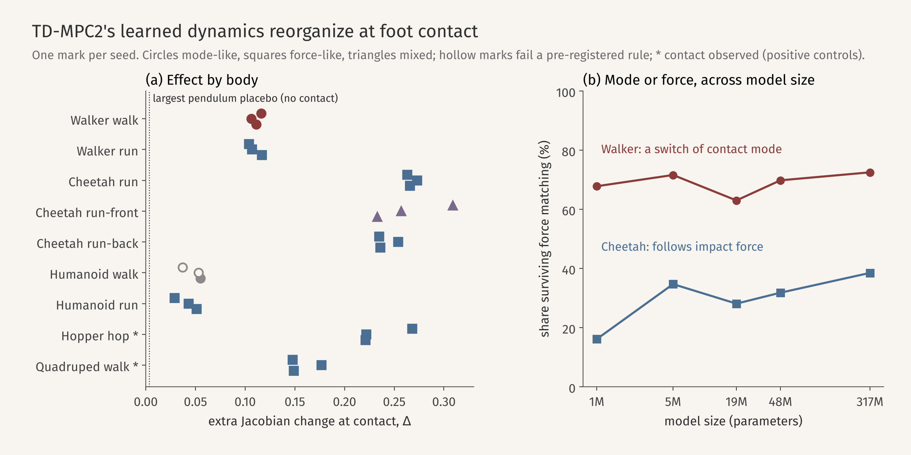
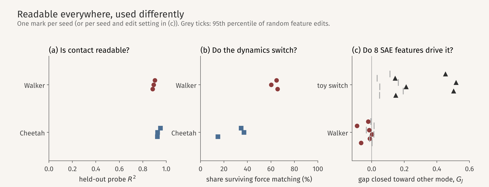
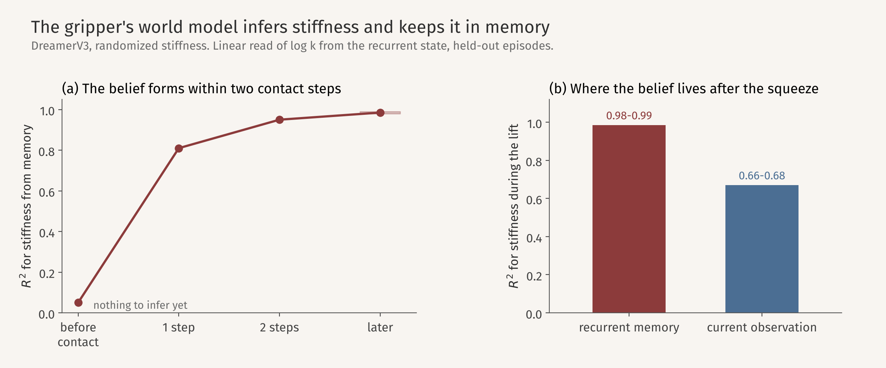
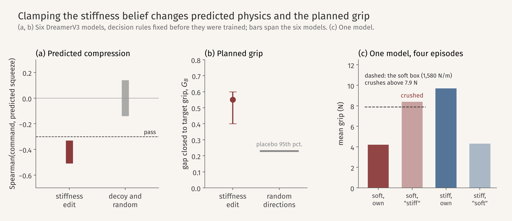
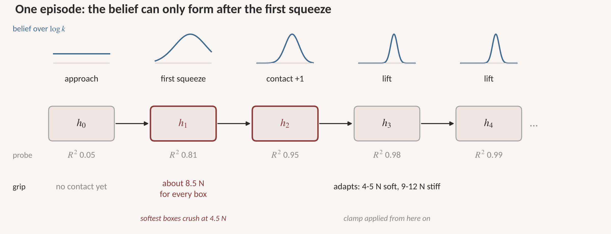

*This post describes ongoing research. The experiments are pre-registered and most have been run, but several are still in progress, so the results below should be read as preliminary.*

In [Part 1](/blog/world-model-beliefs/) I introduced learned world models, the belief that a recurrent model can form about a hidden physical property, and the tools I use to look for it. I also described two testbeds, contact in walking bodies and a gripper handling boxes of hidden stiffness, and four questions about them. This part goes through what I have found so far on each question, and what is still open.

#### Open problems (in progress)

##### 1. Does a learned simulator contain recognizable physics?

###### What I found

I applied the matched-pair test from Part 1 to released TD-MPC2 checkpoints, on fresh episodes. The test passes both of its own controls. On the toy with a known switch it finds the switch at 3.4 to 3.9 times the change seen between same-mode pairs at the same distance, and on the pendulum, which has no contact, the largest placebo boundary gives 0.0033. Across 62,500 episodes, Walker shows an extra change at contact of about 0.11, or 12 to 15% of the same-mode change, and it passes every check in all three seeds. The effect appears in six of the seven bodies where contact is hidden (Figure 1a), and it holds at every model size from 1M to 317M parameters.

*Figure 1. (a) Extra change in TD-MPC2's local dynamics at contact, by body. (b) Share of the effect that survives matching on contact force.*

What the reorganization tracks depends on the body. Cheetah's effect is larger, about 0.26, but it disappears when the comparison pairs are drawn from moments of high impact. When the comparison pairs are also matched on contact force, about two thirds of Walker's effect survives at every model size, against a sixth to two fifths of Cheetah's (Figure 1b). Walker's dynamics appear to switch on whether the foot is touching the ground, which I call mode-like, much like the switching structure found in trained recurrent networks,[^1] while Cheetah's follow the force of the impact, which I call force-like.

###### A second model family

In DreamerV3, Walker walk passes in all three seeds and is again mode-like, and the predictions I made in advance about which bodies would behave like Walker all held. The contact-free pendulum, however, shows changes at arbitrary thresholds as large as Walker's contact effect, so by the same controls I cannot yet say that the reorganization in DreamerV3 is specific to contact.

###### What is still open

My guess is that learned world models do pick up switching structure where the physics has it, but which kind of structure they pick up, and how much that depends on the architecture, is still open. A useful next step is to compare the model's Jacobians with the simulator's own finite-difference Jacobians, which would separate a model that has learned the physics from physics that simply looks this way.

##### 2. Can our tools tell what the dynamics actually use?

###### Probes

A linear probe reads contact from TD-MPC2's internal state with a held-out $$R^2$$ of 0.88 to 0.95 in both Walker and Cheetah (Figure 2a), and it does about as well at every model size. Yet only Walker's dynamics switch on contact (Figure 2b). The probe tells us that contact is encoded, and it is silent on whether the dynamics depend on it.

###### Sparse autoencoder features

A sparse autoencoder on the first dynamics layer, with 512 features of which 32 are active at a time, finds a clean code for the stance phase, the part of the stride when the foot is on the ground, in which 8 features detect contact with an AUROC of 0.93 to 0.97 (where 1 is perfect and 0.5 is chance). Those features account for only 16 to 17% of the extra Jacobian change at contact, which is no more than random features of the same size. Editing them shows the same thing more directly. Setting the 8 features to their values in the other contact mode moves the Jacobian toward that mode on the toy with a known switch, closing 0.14 to 0.52 of the gap against random edits that close at most 0.03 to 0.19, but in Walker the same edit does nothing, with values between -0.09 and 0.003 (Figure 2c). The features describe the switch without carrying it.

*Figure 2. Contact is readable in both bodies (a), but only Walker's dynamics switch on it (b), and editing the autoencoder's contact features changes the dynamics only on the toy (c).*

###### Discovery without labels

Clustering the per-state Jacobians directly, without any labels, recovers contact in Walker and two other bodies, but in no Cheetah gait, where the dynamics vary as much along other directions. Similar concerns about probing have been raised for language models,[^2] and in a physical model they have a sharper consequence, since a probe or a feature can look like a contact detector while the model's dynamics are organized around something else. For these models, interventions scored against the simulator seem necessary, and a reliable way to find the variables that the dynamics actually depend on is an open problem.

##### 3. Can a hidden belief be found and edited, with consequences the physics can check?

###### Does the model learn stiffness?

DreamerV3 models trained on the gripper task with randomized stiffness learn the physics at the right scale. I ask a model to imagine three steps with its own grip and with 3 N more, and read off the predicted extra closure of the fingers, which should fall as $$1/k$$. Across six models the rank correlation with true stiffness is between -0.74 and -0.92, and in the best three the log-log slope is -1.0 to -1.1, so these models have learned the scaling law itself in addition to the ordering of the boxes.

The belief also forms where it should (Figure 3a). Before contact the model's memory reads stiffness at $$R^2 = 0.05$$, after one contact step at 0.81, after two at 0.95, and later at 0.98 to 0.99. Once the lift begins, the current observation alone reads stiffness at only 0.66 to 0.68, while memory keeps it at 0.98 to 0.99 (Figure 3b), so after the squeeze the belief lives in the model's memory.

*Figure 3. (a) How well stiffness can be read from the model's memory as contact proceeds. (b) Memory against the current observation during the lift.*

###### Editing the belief

To edit the belief, I move the memory along the local encoding direction from Part 1 until a probe reads a commanded stiffness $$k'$$, and then repeat the imagined squeeze. Told that the box is stiffer, the model predicts less compression, in proportion to the command, with rank correlations of -0.33 to -0.51 across the six models, while a decoy direction and random directions of the same size stay within 0.14 of zero (Figure 4a). This held in every model that had learned stiffness, 11 of 11 counting these six and five from an earlier round of training. Earlier attempts had taught me that this works only for a variable the model had to infer during training, and only with the local encoding direction in place of the probe's weights.

###### From predictions to the grip

The more important test is whether the edit changes what the robot does. I let the world model plan the grip by model-predictive control over 48 candidate plans, clamp the belief from the third step onward, and measure how much of the gap the grip closes toward what the same model does, unedited, for a box of the commanded stiffness. With decision rules fixed before these models were trained, the clamped grip closes 0.55 of the gap (95% interval 0.40 to 0.60), against 0.23 for the 95th percentile of random directions (Figure 4b), which replicates an earlier result of 0.53 on independently trained models. Figure 4c shows the model of Figure 1 in Part 1, in which a soft box clamped to "stiff" is gripped at 8.4 N and crushed, and a stiff box clamped to "soft" is lifted gently at 4.3 N.

*Figure 4. Effect of clamping the stiffness belief, across six models (a, b) and in four episodes of one model (c).*

###### What is still open

All of this is a single simulated task with a spring model of compliance. An earlier attempt on Walker, with a hidden payload or motor strength, found beliefs that could be read but could not be shown to be steerable, because the physical change they caused was small compared with the model's own prediction error. Whether beliefs about properties like mass and friction can be found and edited in larger models trained on more varied data is the open question, and measuring whether an edit works turns out to be part of it.

##### 4. How should a robot act before its belief exists?

###### The first squeeze

Every model I have trained crushes between 45% and 85% of the softest boxes. The reason is the information bound from Part 1. The first squeeze is about 8.5 N whatever the object, since the model cannot yet know what it is holding, and the softest boxes crush at 4.5 N. After that first squeeze the grip adapts as it should, to 4 to 5 N on soft boxes and 9 to 12 N on stiff ones (Figure 5). Interpretability cannot help at this point, since a belief that does not yet exist can be neither read nor corrected.

*Figure 5. One episode, step by step (schematic, with the probe values of Figure 3).*

###### Probing gently first (running now)

People avoid this by probing first,[^3] and the simulator check in Part 1 showed that a 1 N squeeze reveals stiffness without crushing anything. The experiment running now replaces the first three steps of every episode with a 1 N squeeze and then lets the planner act. It passes if fewer than 10% of the softest boxes are crushed, if the grip still follows stiffness with a rank correlation above 0.4, and if the steering rules above still hold. One known risk is that the models never saw a gentle squeeze during training and may not read it. More generally, I think a robot that acts on beliefs also needs a safe way to gather the evidence that forms them, and that this is a separate problem from reading the belief once it exists.

#### Why this matters

In an [earlier post](/blog/bluedot-pipeline-open-problems/) I argued that most open problems in AI safety are, at heart, problems of observation. A robot's world model is a concrete case of this. It holds beliefs about the physical world that decide what the robot does, and for physical systems there is a simulator against which every claim about those beliefs can be checked. Being able to inspect such a belief before the robot acts, and to correct it when it is wrong, is a form of oversight that we do not yet have.[^4] I hope to share fuller results as the remaining experiments finish, and I would be glad to hear from anyone working on related questions.

*A robot forms its belief about an object by touching it, which is also when it can do the most damage.*

[^1]: Smith, Linderman and Sussillo (2021). Reverse engineering recurrent neural networks with Jacobian switching linear dynamical systems. NeurIPS.
[^2]: Belinkov (2022). Probing Classifiers: Promises, Shortcomings, and Advances. *Computational Linguistics* 48(1); and Elazar, Ravfogel, Jacovi and Goldberg (2021). Amnesic Probing: Behavioral Explanation with Amnesic Counterfactuals. *TACL* 9.
[^3]: Johansson and Flanagan (2009). Coding and use of tactile signals from the fingertips in object manipulation tasks. *Nature Reviews Neuroscience* 10: 345-359.
[^4]: Amodei, Olah, Steinhardt, Christiano, Schulman and Mané (2016). Concrete Problems in AI Safety. arXiv:1606.06565.
