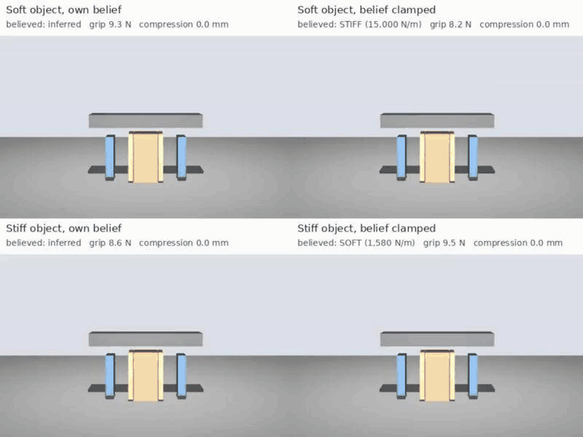
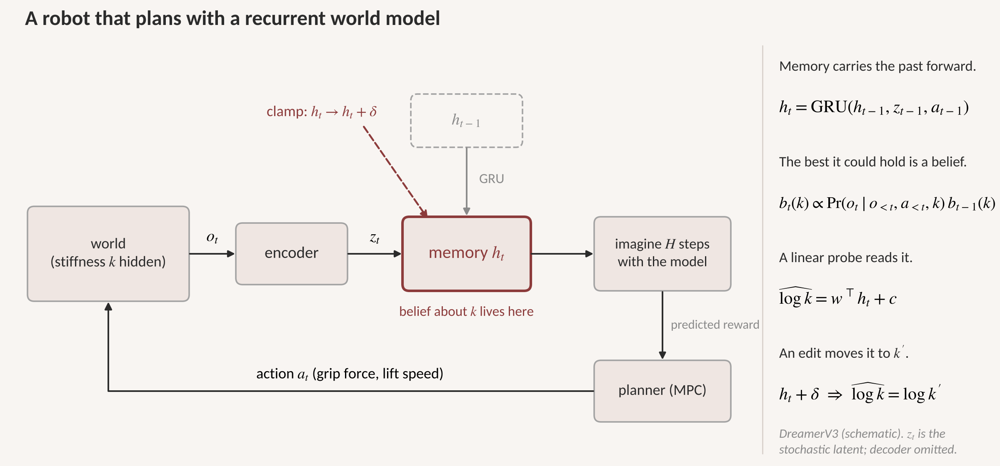
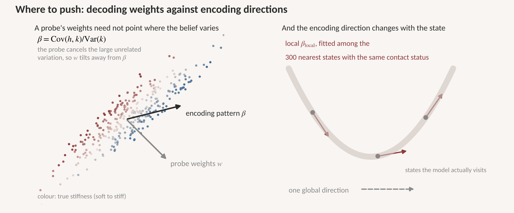
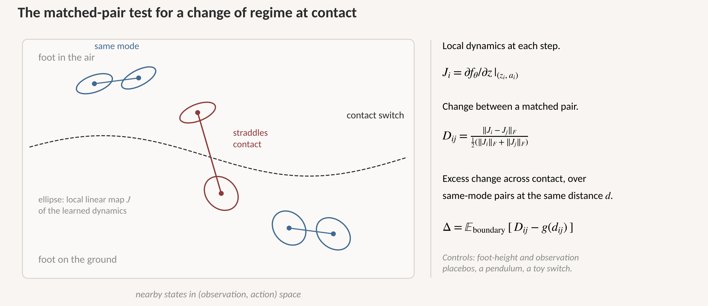
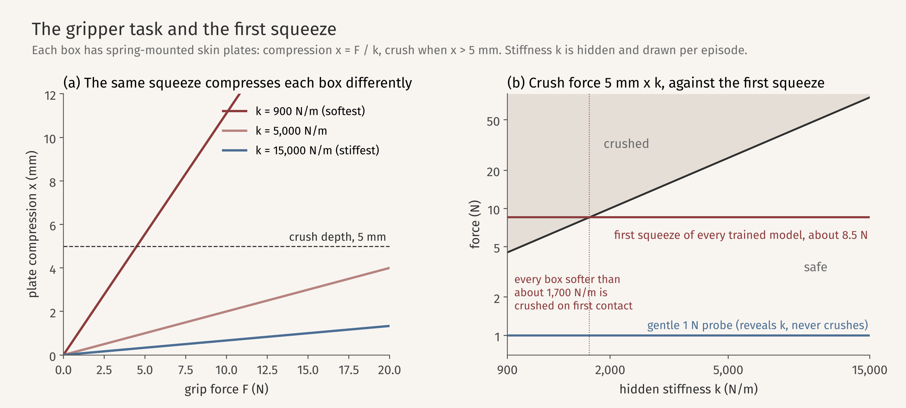

*This is the first of two posts on ongoing research. This part introduces the ideas and sets out the problem, and [Part 2](/blog/world-model-beliefs-part-2/) describes preliminary findings and the open problems I am working on.*

When we pick up an unfamiliar object, we usually squeeze it gently first and then settle on a grip just above what the task needs. The adjustment happens within about a tenth of a second of contact, and it rests on an estimate of the object that we form by touching it and never have to state.[^1]

Robots are beginning to work in a similar way. A growing number of robot controllers plan with a learned world model, a network trained on experience to predict what happens next, and choose their actions by imagining the consequences. When a robot of this kind plans a grasp, it acts on what its model believes about the object. That belief sits in the model's internal state, and at present we have no reliable way to read it or to correct it.

We can often read a physical property out of a robot's world model. What we cannot yet do reliably is tell whether the model uses that property, or change it and know what the robot will do as a result.

*Figure 1. One model, four episodes, slowed down. Each box is gripped with the model's own belief (left) and with the belief clamped to the opposite stiffness (right).*

Figure 1 shows what this looks like in practice. A gripper's world model has inferred that the box is soft and lifts it at about 4 N. When I overwrite the model's belief so that it takes the box to be stiff, its planner chooses about 8 N and crushes the box. The edit is a single change to the model's memory, and nothing about the box or the controller has changed. The bottom row shows the opposite edit, in which a stiff box that the model is told is soft is lifted with less than half its usual grip.

#### Robots that plan in imagination

A world model learns to predict what happens next. At each step the robot receives an observation $$o_t$$, such as joint angles and finger forces, and an encoder compresses it into a latent state $$z_t = E_\theta(o_t)$$. A dynamics network then predicts the next latent state from the current one and the action, $$z_{t+1} = f_\theta(z_t, a_t)$$, along with the reward. Training asks these predictions to match what actually happened in the robot's experience.

Once the model is trained, the robot can try out actions in imagination before taking any of them. In model-predictive control it imagines several candidate action sequences over a short horizon $$H$$, scores each by the rewards its model predicts, $$\sum_{\tau=0}^{H-1}\gamma^\tau \hat r_{t+\tau}$$, executes the first action of the best one and then plans again at the next step. TD-MPC2 plans this way in latent space, with models of up to 317M parameters.[^2]

Dreamer adds a memory.[^3] Its state has a recurrent part $$h_t = \mathrm{GRU}_\theta(h_{t-1}, z_{t-1}, a_{t-1})$$, updated by a gated recurrent unit and carried from step to step, so the model can accumulate evidence that no single observation contains. The difference matters for what follows. TD-MPC2's encoder sees only the current observation, so anything it knows has to be visible at that moment, while Dreamer's memory can hold on to something it learned a few steps ago. Figure 2 shows where that memory sits in the planning loop, and where an edit to it would act.

*Figure 2. A recurrent world model in the planning loop (schematic).*

#### What a belief about physics looks like

Suppose each episode hands the robot a box whose stiffness $$k$$ is drawn at random and never shown to it. This is a hidden-parameter problem.[^4] The best any agent could do is keep a belief over $$k$$ and update it with every observation,

$$b_t(k) \;\propto\; \Pr\left(o_t \mid o_{\lt t}, a_{\lt t}, k\right) b_{t-1}(k),$$

which is Bayes' rule applied one step at a time. A recurrent world model trained to predict observations across many such episodes is never told to do this. Once the fingers touch the box, however, how they move depends on $$k$$, so the model can predict them well only by carrying information about $$k$$ in its memory. In effect the model performs system identification implicitly, which adaptive controllers do explicitly.[^5]

Two features of this belief shape everything in Part 2. The first is that it is bounded by what the observations reveal. Before the fingers touch the box, nothing the robot sees depends on $$k$$, so no model, however well trained, can know it. The second is that the belief has physical units, so it makes predictions we can check. If a box's skin plates sit on springs, a grip force $$F$$ compresses them by $$x = F/k$$. A model that has learned stiffness at the right scale should therefore predict that an extra 3 N closes the fingers by $$3/k$$ more, which is a line of slope $$-1$$ when the predicted closure is plotted against $$k$$ on log-log axes.

#### Why physical world models

Interpretability research has found internal models of the world in systems trained on games and text,[^11] but there the effect of an edit can only be judged by the model's own output. Being able to inspect what a model believes before it acts, and to correct a wrong belief, is one of the basic forms of oversight that work on AI safety has argued for.[^12] For a robot the stakes are concrete, since a wrong belief about an object can do damage before anyone notices.

Physical world models add something these settings usually lack, which is ground truth for every intervention. If we edit a belief and the model predicts a new outcome, we can run the simulator with the corresponding physics and check whether the prediction is right. Since interpretability methods can find structure almost anywhere, every experiment here was pre-registered before its data existed, with a positive control the method must pass and a negative control it must fail.

#### How we look inside a model

A *linear probe* asks whether a quantity can be read from the model's state.[^6] We fit $$\hat k = w^\top h + c$$ by ridge regression on one set of episodes and measure the $$R^2$$ on another. A high $$R^2$$ says the information is present, and nothing more. In particular it does not say that the model uses it, and probes can succeed even on networks with random weights,[^7] so a probe result needs a baseline on which it should fail.

A *sparse autoencoder* rewrites the state as a combination of a few features out of many,[^8] $$\mathbf f = \mathrm{TopK}_m\big(W_e(h - b)\big)$$ and $$\hat h = W_d \mathbf f + b$$, where only the $$m$$ largest entries of $$\mathbf f$$ are kept. The hope is that single features line up with things we can name, such as the foot being on the ground, and that changing a feature changes what the model does.

*Steering* asks whether changing the state changes the behaviour.[^9] We add a direction $$\delta$$ to $$h$$ and watch what the model predicts or does. The question is which direction to use. A probe's weights $$w$$ are decoding weights, chosen to read $$k$$ out while cancelling everything else, and they can point well away from the direction along which $$k$$ actually varies in the state. That direction, the encoding pattern (Figure 3, left), is $$\beta = \mathrm{Cov}(h, k)/\mathrm{Var}(k)$$.[^10] In a nonlinear model it also changes from one region of the state space to another (Figure 3, right), so the edit I use is fitted locally, among the 300 nearest states, and moves the state by $$\delta = \beta_{\mathrm{local}}\,(k' - \hat k)$$ to make the model believe a commanded stiffness $$k'$$.

*Figure 3. Decoding weights against encoding directions (schematic).*

#### Two testbeds

The first testbed is contact in walking bodies from the DeepMind Control suite. When a foot touches the ground the physics changes abruptly, and learned dynamics models are known to have difficulty with it.[^13] Most of these bodies never observe contact directly, so if TD-MPC2's learned dynamics change at touchdown, the model has found something like a contact regime on its own. 

To test this I compare the local dynamics of nearly identical states. Let $$J_i$$ be the Jacobian of the learned transition at step $$i$$, the matrix that says how the predicted next state responds to a small change in the current one. Each step is paired with its five nearest neighbours from other episodes, and the relative change $$D_{ij} = \lVert J_i - J_j \rVert_F \,/\, \tfrac12\left(\lVert J_i \rVert_F + \lVert J_j \rVert_F\right)$$ is compared between pairs that straddle a contact switch and pairs at the same distance that do not (Figure 4). Nearby states should have similar Jacobians unless something switches between them, so an excess of change across contact, over what same-mode pairs show at the same distance, is the signature of a regime change. The controls include placebo boundaries that have nothing to do with contact, a pendulum with no contact at all, and a toy with a known switch that the test has to find.

*Figure 4. The matched-pair test (schematic).*

The second testbed is a gripper task in MuJoCo, built to study a property that is never observed. A two-finger gripper squeezes and lifts boxes whose stiffness is drawn per episode between 900 and 15,000 N/m. Each box has skin plates on springs, so compression follows $$x = F/k$$ (Figure 5a), and the box is crushed once compression passes 5 mm, which happens at 4.5 N for the softest box and 75 N for the stiffest. A time bonus rewards lifting quickly, so the best grip depends on stiffness. The task also has a decoy, a hidden inertia scale that this task never excites, on which a valid steering method has to fail.

*Figure 5. (a) Compression of three boxes under the same grip. (b) The force that crushes each box, against the first squeeze of the trained models.*

Figure 5b also marks the grip that every trained model uses on its first squeeze, which Part 2 returns to. Before training anything, I checked in simulation that a single gentle squeeze of 1 N reveals stiffness without crushing a box ($$R^2 = 0.92$$ for $$\log k$$ from finger position and force), and that a strategy ignoring stiffness loses 27% of the achievable reward.

#### The questions

With these pieces in place, the research comes down to four questions.

1. Does a learned simulator contain recognizable physics, such as a change of regime at contact?
2. Can our usual tools tell what the learned dynamics actually use, as opposed to what they merely encode?
3. Can a hidden physical belief be found and edited, with consequences that the physics can check?
4. How should a robot act before its belief exists?

In [Part 2](/blog/world-model-beliefs-part-2/) I describe what I have found so far on each, and what is still open.

[^1]: Johansson and Flanagan (2009). Coding and use of tactile signals from the fingertips in object manipulation tasks. *Nature Reviews Neuroscience* 10: 345-359.
[^2]: Hansen, Su and Wang (2024). TD-MPC2: Scalable, Robust World Models for Continuous Control. ICLR.
[^3]: Hafner, Pasukonis, Ba and Lillicrap (2023). Mastering Diverse Domains through World Models. arXiv:2301.04104; and Wu, Escontrela, Hafner, Goldberg and Abbeel (2022). DayDreamer: World Models for Physical Robot Learning. CoRL.
[^4]: Doshi-Velez and Konidaris (2016). Hidden Parameter Markov Decision Processes: A Semiparametric Regression Approach for Discovering Latent Task Parametrizations. IJCAI.
[^5]: Yu, Tan, Liu and Turk (2017). Preparing for the Unknown: Learning a Universal Policy with Online System Identification. RSS; and Kumar, Fu, Pathak and Malik (2021). RMA: Rapid Motor Adaptation for Legged Robots. RSS.
[^6]: Alain and Bengio (2016). Understanding intermediate layers using linear classifier probes. arXiv:1610.01644.
[^7]: Hewitt and Liang (2019). Designing and Interpreting Probes with Control Tasks. EMNLP.
[^8]: Bricken et al. (2023). Towards Monosemanticity: Decomposing Language Models with Dictionary Learning. Transformer Circuits Thread; and Gao et al. (2024). Scaling and Evaluating Sparse Autoencoders. arXiv:2406.04093.
[^9]: Turner et al. (2023). Activation Addition: Steering Language Models Without Optimization. arXiv:2308.10248.
[^10]: Haufe et al. (2014). On the interpretation of weight vectors of linear models in multivariate neuroimaging. *NeuroImage* 87: 96-110.
[^11]: Li, Hopkins, Bau, Viégas, Pfister and Wattenberg (2023). Emergent World Representations: Exploring a Sequence Model Trained on a Synthetic Task. ICLR; and Gurnee and Tegmark (2024). Language Models Represent Space and Time. ICLR.
[^12]: Amodei, Olah, Steinhardt, Christiano, Schulman and Mané (2016). Concrete Problems in AI Safety. arXiv:1606.06565.
[^13]: Parmar, Halm and Posa (2021). Fundamental Challenges in Deep Learning for Stiff Contact Dynamics. IROS.
